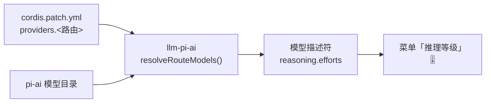
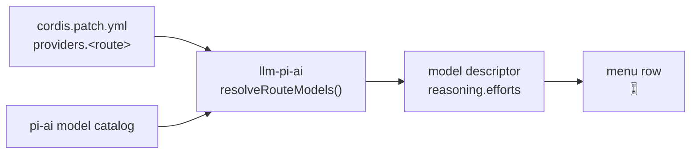

# dsh-reasoning-presets

**给 DSH 里那些「能聊、但选不了推理等级」的模型补上档位配置，并把模型菜单的「推理等级」那一行变成可拖动滑条。**

[](LICENSE)
[](https://nodejs.org)
[](https://github.com/deepseek-ai)

[中文](#中文) · [English](#english)

---

## 中文

### 这个插件是干什么的

DSH 的模型菜单里有一行「推理等级」。它是否出现、有哪几档，**完全由模型描述符里的 `reasoning.efforts` 决定**，而这个描述符来自 `llm-pi-ai` 适配器对 pi-ai 模型目录的解析：



于是只有两种情况：

| 你的路由 id | 目录是否认识 | 结果 |
| --- | --- | --- |
| 与目录同名（`deepseek`、`openai`、`anthropic`、`zai` …） | 认识 → 元数据自动继承 | 档位直接出现 |
| 自己起的名（`glm`、`claude`、中转站别名） | 不认识 → `reasoning: false` | **这一行不出现，也就无从设置** |

第二种情况必须手写 `reasoningEfforts`（档位 → 线上取值），必要时再写 `compat`（各家 chat 协议的思考参数长得不一样）。写错一个字段，轻则滑条不出现，重则请求 400。

**本插件的职责就是把这一层配置自动化，并让菜单里的档位可拖。** 它不代理请求、不改模型能力，只做三件事：

| 能力 | 怎么触发 | 说明 |
| --- | --- | --- |
| **体检** | `audit` / `reasoning_presets` 工具 | 列出每条路由、每个型号是否支持推理、支持哪几档、缺什么 |
| **补齐** | `fix --write` 或插件启动时自动执行 | 缺 `reasoningEfforts` / `api` / `compat` / 默认档，按目录与家族规则补上，逐条列出改动 |
| **滑条** | 装成插件后自动生效 | 把菜单「推理等级」那一行就地变成可拖动滑条，拖动即换档；档位弹窗按同一套渐变换色 |

附带两个便于工程化的能力：`check` 只回答「配置还干不干净」（漂移即非零退出，可进 CI）；`init` 直接生成一条「继承目录」的干净路由。

### 怎么用

推荐路径是**装成插件**：装完重启一次，之后新加的路由会在每次启动时被自动补齐，滑条也随插件一起出现。

#### 方式一：装成 DSH 插件（推荐）

```text
plugin_manager install_bundle  target: github:tancy9527/dsh-reasoning-presets#v1.4.3
```

也可以在图形界面里：设置 → 插件 → 添加插件 → 填 `https://github.com/tancy9527/dsh-reasoning-presets`。

装完 **重启一次 DSH**（bundle 与客户端半边都是启动时装载的，安装接口会返回 `application: restart-required`）。重启之后：

1. 缺档位的路由被自动补齐（只补不覆盖，写盘前留 `cordis.patch.yml.<时间戳>.bak`，改动记进 `cordis.patch.reasoning-presets.log`）
2. 模型菜单的「推理等级」那一行下方长出滑条
3. 多出一个 `reasoning_presets` 工具，可以直接让 agent 帮你查/改

不想让它自动改配置：在 profile 的 patch 条目里加 `config: { autoFix: false }`。

#### 方式二：只用命令行（不装插件，改配置走 HMR）

需要 Node ≥ 20。profile 的 `cordis.patch.yml` 在 DSH 的 HMR 监听列表里，**写完自动生效，不用重启**（这种方式不会有滑条，只是把档位配置补对，官方菜单里照常出现档位选项）。

```bash
node bin/cli.mjs root          # 1. 确认探测到的 DSH 目录与 profile
node bin/cli.mjs audit         # 2. 体检：谁有档位、谁没有、缺什么
node bin/cli.mjs fix           # 3. 预演修复（默认 dry-run，不写盘）
node bin/cli.mjs fix --write   # 4. 真写（自动备份 .bak）
```

从源码用就 `git clone` 后跑上面的命令；装到全局则直接用 `dsh-reasoning audit`、`dsh-reasoning check`、`dsh-reasoning fix --write`。

### 它用什么方法

**1. 以配置为唯一真源，优先继承而不是手写。**

`reasoningEfforts` 的语义是「键 = 菜单里出现的档位，值 = 真正发给上游的字符串」。手写容易出错，所以插件优先让路由**继承 pi-ai 目录**：只要路由 id 与目录同名（`deepseek`、`openai`、`zai`…），档位、协议、`compat` 全部自动回填，你只写 `apiKeyEnv` 和 `baseURL` 即可。只有目录里没有的路由才需要显式声明。

**2. 目录里没有的型号，用家族规则兜底。**

中转站与刚发布的型号（`claude-sonnet-5-5`、`glm-5.3-flashx`…）不在目录里，插件按命名规律匹配厂商家族，补上协议与档位：

| 家族 | 匹配型号 | 协议 | 补的档位 |
| --- | --- | --- | --- |
| 智谱 GLM 5.3 | `glm-5.3*`、`glm-5-turbo` | `openai-completions` + `thinkingFormat: zai` | 低 / 高 / 最大（官方禁止关闭思考） |
| 智谱 GLM 5.2 | `glm-5.2*`、`glm-5` | 同上 | 关闭（`none`）/ 低 / 高 / 最大 |
| Claude 5.x | `claude-opus-5*`、`claude-sonnet-5*`、`claude-fable-5*` | `anthropic-messages` | 关闭 / 极简 / 低 / 中 / 高 / 极高 / 最大 |
| Claude Haiku | `claude-haiku*` | 同上 | 关闭 / 低 / 中 / 高（保守，避免上游拒绝） |

优先级固定为**同名目录 > 厂商目录 > 家族规则 > 聚合商目录**：聚合商（如 openrouter）对同一个型号常常少列档位，不能让它们的声明盖住官方能力。

**3. 只补不覆盖，写盘可回滚。**

已经手写过的 `reasoningEfforts` / `reasoning` 一律不动；只补缺失项。每次写盘前留 `.bak`，写后记日志，重复运行不再写盘（幂等）。

**4. 顺带补默认档，避免「Default」把请求打空。**

路由上没有 `reasoning:` 时，DSH 会在菜单里补一个「Default」伪项，含义是**请求里不带任何 effort**。对「禁止关闭思考」的型号（GLM-5.3 系列等）这有 400 风险。`fix` 因此会给缺默认档的路由补 `reasoning: high`。

**5. 滑条是客户端上的可逆挂载，走官方服务。**

滑条不是重画菜单，而是：

- 监听模型菜单的展开状态，定位**根面板里恰好两行 `button[role="menuitem"]`** 中的「推理等级」那一行
- 只对该行做三件可逆的事：加高、允许折行、追加一个容器；关菜单或卸载时逐项还原，不碰官方 class 与 React 树
- 档位读写全部走官方 `ctx.modelDirectories`：`select({ provider, model, reasoningEffort })`，失败自动回滚并显示错误码
- 档位 < 2 的模型**完全不挂**（不显示假档位）；同一行用 `data-rp-owner` 标记归属，多会话不会叠出两条
- 发现同一行已被别的滑条插件（`.ces-inline`）占用，就把对方容器临时 `display:none` 收起、卸载时还原，不会出现两条同步的滑条
- 档位子面板（低 / 高 / 最大…）里每一项按滑条同一套渐变换色：最低档取轨道起点的蓝，最高档取终点的紫，中间档按位置插值；关掉子面板即还原官方颜色（认不出的项如「Default」不动）
- 菜单结构不是已知形状时只 warn 一次，什么都不做

> 观感参考了 MIT 许可的 [`dsh-codex-effort-slider`](https://github.com/Microqian2th/dsh-codex-effort-slider)（作者 Microqian2th）。本实现未复制其源码：无设置面板、无遥测、不注入 React 树，只用原生 DOM 可逆挂载，并按 DSH 别名 token 取色以适配明暗主题。

### 命令参考

| 命令 | 作用 |
| --- | --- |
| `dsh-reasoning root` | 打印探测到的 DSH 安装目录、pi-ai 目录、profile 补丁路径 |
| `dsh-reasoning list [--all] [--markdown]` | 供应商档位矩阵（默认只列推荐路由） |
| `dsh-reasoning audit [--markdown] [--json]` | 体检当前 profile，列出问题与可修项 |
| `dsh-reasoning check [--strict] [--json]` | 漂移检查：干净 exit 0，有漂移 exit 1（CI / pre-commit） |
| `dsh-reasoning fix [--write] [--effort high] [--no-default]` | 补齐配置；默认 dry-run |
| `dsh-reasoning init <id…> [--write]` | 新建继承目录的路由 |

通用参数：`--profile <dir>`、`--patch <file>`、`--dsh-root <dir>`、`--base-url id=url`（中转站覆盖 `baseURL`）。

`check` 的口径：可修项（`MISSING_LEVELS`）、未知型号、缺协议、有风险的缺默认档算「脏」；「只是菜单多一个 Default 伪项」这类提示级只有 `--strict` 才算脏。

agent 侧工具 `reasoning_presets` 的参数：`action`（`list` / `audit` / `check` / `fix` / `init`）、`providers[]`、`effort`、`strict`、`write`、`applyDefault`、`profile`、`dshRoot`。

### 配置长什么样

**自定义路由（目录里没有）——必须写全：**

```yaml
- id: llm-pi-ai
  name: "@deepseek-ai/dsh-llm-pi-ai"
  config:
    providers:
      glm:
        apiKeyEnv: GLM_API_KEY
        api: openai-completions          # 智谱的思考参数在 chat 协议里，不在 responses
        baseURL: https://open.bigmodel.cn/api/paas/v4
        reasoning: high                  # 默认档；不写菜单会多出 "Default"
        compat:
          thinkingFormat: zai            # 走 zai 的 thinking / reasoning_effort 分支
          supportsReasoningEffort: true
          maxTokensField: max_tokens
          supportsStore: false
          supportsDeveloperRole: false
          supportsStrictMode: true
        models:
          - id: glm-5.3                  # 5.3 系列：官方禁止关闭思考
            reasoningEfforts: { low: low, high: high, max: max }
          - id: glm-5.2                  # 5.2 系列：可以关
            reasoningEfforts: { off: none, low: low, high: high, max: max }
```

**目录里已有的供应商——路由 id 同名即可，档位不用写：**

```yaml
      deepseek:                # id 与目录同名，档位/协议自动继承
        apiKeyEnv: DEEPSEEK_API_KEY
        reasoning: high
```

### 覆盖范围

内置目录包含 41 个供应商路由、1495 个模型，其中 1222 个声明了 ≥2 个档位。常见几家：

| 供应商（路由 id） | 档位 |
| --- | --- |
| `openai` | 关闭 / 极简 / 低 / 中 / 高 / 极高 / 最大 |
| `anthropic` | 关闭 / 极简 / 低 / 中 / 高 / 极高 / 最大 |
| `google` | 关闭 / 极简 / 低 / 中 / 高 |
| `xai` | 关闭 / 低 / 中 / 高 / 极高 |
| `deepseek` | 关闭 / 低 / 高 / 最大 |
| `moonshotai` / `-cn` | 关闭 / 极简 / 低 / 中 / 高 / 最大 |
| `qwen-token-plan` / `-cn` | 关闭 / 极简 / 低 / 中 / 高 / 极高 / 最大 |
| `zai` | 关闭 / 低 / 高 / 最大 |
| `zai-coding-cn` | 低 / 高 / 最大（禁关） |

完整矩阵见 [`docs/MATRIX.md`](docs/MATRIX.md)（由 `dsh-reasoning list --markdown --all` 生成）。目录里没有的型号由上面的家族规则兜底；两边都认不出的（如 `ghost-9000`）需要手写，`audit` 会把它们单独列为「目录未收录 · 需手写」。

### 实测记录

以下都是对真实链路（`dsh-llm-pi-ai` → pi-ai `openai-completions` → 上游 `/chat/completions`）发出的请求，不是纸面推演：

| 档位 | 思考 tokens | 思考文本 | 回答长度 |
| --- | --- | --- | --- |
| 低 `low` | **0** | 无 | 464 字 |
| 高 `high` | **553** | 1751 字 | 388 字 |
| 最大 `max` | **449** | 1514 字 | 513 字 |

（智谱 GLM-5.3，同一问题只改档位。）低档完全不思考、高档稳定思考上千字，说明档位确实作用到了线上参数 `thinking:{type:"enabled"}` + `reasoning_effort`。

其他已验证的事实：

- **DeepSeek** 官方 `deepseek-chat` 正常 200，`reasoning_effort` 生效
- **Claude** 只做了请求体层面验证（中转站欠费，上游在参数校验前就返回 403）：DSH 会发 `thinking:{type:"enabled", budget_tokens: 2048 | 16384, display:"summarized"}`，低档 2048、其余 16384，选「关闭」则完全不发 `thinking`。想用新版 `thinking:{type:"adaptive"}` + `output_config.effort`，需要路由 id 与目录同名（`anthropic`）才能继承 `compat.forceAdaptiveThinking`
- **自动补齐**：把真实 profile 剥空档位后走一遍启动流程 → 补齐 11 处、生成 `.bak` 与日志，补齐结果用 `dsh-llm-pi-ai` 的 `Config` 校验通过；再启动一次返回 `clean` 且文件字节不变（幂等）
- **`check`**：当前 profile → `✓ 配置干净` exit 0；剥空后 → `✗ 有 11 处需要处理` exit 1
- **滑条**：用假 `window.__ModuleLoader__` + 假 React + 最小假 DOM 在 Node 里装配，验证了注册、fail-open、加高折行、拖动途中不提交 / 松手提交一次 / 落点相同不提交、能量层点亮、卸载后样式与 DOM 全还原
- 全仓 **42 项断言**（`node test/*.test.mjs`）

### FAQ

**Q：装完之后菜单里没有滑条？**
A：三个常见原因。①没重启（bundle 与客户端半边都是启动时装载的）；②当前模型档位 < 2（没有可选项，这是设计上的「宁可不显示」）；③该模型根本没有声明 `reasoningEfforts`——先跑 `dsh-reasoning audit` 看它属于哪一类。

**Q：为什么菜单里多了一项「Default」？**
A：它不是档位，是 `defaultEffort` 缺失时 DSH 自动补的伪选项，含义是「请求里不带 effort」。对禁止关闭思考的型号（GLM-5.3 系列）有 400 风险；给路由写上 `reasoning: high` 即可让它消失。

**Q：改配置要重启，装插件也要重启，有什么区别？**
A：改 `cordis.patch.yml` 不用重启（HMR 热更新）。装/升级插件要重启一次，因为 bundle 与客户端产物是启动时装配的。

**Q：改坏了怎么办？**
A：`--write` 每次都先存 `cordis.patch.yml.<ISO时间戳>.bak`，直接还原即可；拿不准就先跑 dry-run。

**Q：我已经装了别的滑条插件（比如 dsh-codex-effort-slider），会冲突吗？**
A：不会叠成两条。我们检测到同一行已被占用时会把对方容器临时收起（只改 `display`），卸载时还原；想用对方那条，就卸掉我们。

**Q：为什么我的 `node --test` 报 `spawn EPERM`？**
A：那是在受限沙箱里；逐个文件跑即可：`node test/levels.test.mjs` 等七个文件。

**Q：用同一个 `github:` 地址升级时报 `ambiguous-install`？**
A：这是插件管理器靠「spec 字符串有没有变」识别安装目标导致的，文件其实已经更新。重启 DSH 即生效；想让它登记成一次安装，就换写法（如 `#v1.4.3`）或先移除再装。

### 仓库结构

```
lib/levels.mjs    档位规则（supportedLevels / effortsFor / pickDefaultLevel）
lib/catalog.mjs   定位 DSH 安装目录 + 读 pi-ai 目录
lib/presets.mjs   供应商元数据（apiKeyEnv / 中文名 / 文档链接）
lib/patch.mjs     cordis.patch.yml 读写（保留注释、自动备份）
lib/audit.mjs     audit / check / fix / init 四个核心算法
lib/recipes.mjs   家族规则（目录里没有的 glm-* / claude-* 型号）
lib/autofix.mjs   启动时自动体检 + 只补不覆盖地修复配置
lib/render.mjs    文本与 markdown 渲染
lib/index.mjs     插件入口（reasoning_presets 工具 + 启动自动补齐）
lib/client.js     客户端半边：菜单「推理等级」那一行变成可拖动滑条
bin/cli.mjs       命令行（root / list / audit / check / fix / init）
test/             node:test 用例（42 项）
docs/PLUMBING.md  机制详解：reasoningEfforts 语义、目录继承、compat 白名单、各家 wire 差异
docs/MATRIX.md    供应商档位矩阵
```

想搞清楚底层细节（`reasoningEfforts` 的 `false` / `null` / 缺省三种特殊值、目录继承规则、各协议 compat 白名单、常见报错对照）读 [`docs/PLUMBING.md`](docs/PLUMBING.md)。

### License

MIT © 2026 tancy9527

---

## English

### What this plugin does

DSH renders a "reasoning effort" row in its model menu **only when the model descriptor carries `reasoning.efforts`**, and that descriptor comes from how the `llm-pi-ai` adapter resolves the pi-ai model catalog:



| Your route id | Known to the catalog? | Result |
| --- | --- | --- |
| Same as a catalog provider (`deepseek`, `openai`, `anthropic`, `zai` …) | yes → metadata inherited | levels appear |
| Your own name (`glm`, `claude`, relay aliases) | no → `reasoning: false` | **row absent, nothing to set** |

Custom routes must declare `reasoningEfforts` (level → wire value) by hand, plus `compat` where the provider's thinking parameters differ. One wrong field and the row disappears or requests start failing with 400.

**This plugin automates that config layer and makes the row draggable.** It does not proxy requests or change model capabilities. Three things:

| Capability | Trigger | What it does |
| --- | --- | --- |
| **Audit** | `audit` / `reasoning_presets` tool | Lists every route and model: reasoning support, available levels, what is missing |
| **Repair** | `fix --write`, or automatically on start | Fills in missing `reasoningEfforts` / `api` / `compat` / default level, reporting each change |
| **Slider** | once installed as a plugin | Turns the menu's effort row into a draggable slider |

Plus two engineering helpers: `check` (drift ⇒ non-zero exit, CI-friendly) and `init` (generate a clean catalog-inheriting route).

### How to use it

The recommended path is to **install it as a DSH plugin**: restart once, and later routes get repaired on every start while the slider comes along with the plugin.

#### Option 1: install as a plugin (recommended)

```text
plugin_manager install_bundle  target: github:tancy9527/dsh-reasoning-presets#v1.4.3
```

Or in the GUI: Settings → Plugins → Add plugin → `https://github.com/tancy9527/dsh-reasoning-presets`.

**Restart DSH once** (bundles and client halves are loaded at startup; the install call returns `application: restart-required`). After the restart:

1. routes without levels are repaired (additive only, `cordis.patch.yml.<timestamp>.bak` written first, changes logged to `cordis.patch.reasoning-presets.log`)
2. the slider appears under the menu's effort row
3. a `reasoning_presets` tool is registered

Disable the auto-repair with `config: { autoFix: false }` on the plugin's patch entry.

#### Option 2: CLI only (no bundle)

Node ≥ 20. The profile's `cordis.patch.yml` is watched by DSH's HMR, so **writes apply without a restart** (no slider this way — it only fixes the config, so the stock menu shows the levels).

```bash
node bin/cli.mjs root          # 1. confirm detected DSH dir and profile
node bin/cli.mjs audit         # 2. who has levels, who does not, what is missing
node bin/cli.mjs fix           # 3. dry run
node bin/cli.mjs fix --write   # 4. write (auto .bak)
```

### How it works

**1. Config is the only source of truth; inherit before declaring.** `reasoningEfforts` maps menu levels to wire strings. Rather than hand-writing them, the plugin lets a route inherit the pi-ai catalog whenever the route id matches a catalog provider — levels, protocol and `compat` come for free. Only unknown routes need explicit declarations.

**2. Family rules cover what the catalog doesn't know.** Relays and freshly released model ids are matched by name:

| Family | Match | Protocol | Levels |
| --- | --- | --- | --- |
| Zhipu GLM 5.3 | `glm-5.3*`, `glm-5-turbo` | `openai-completions` + `thinkingFormat: zai` | low / high / max (thinking cannot be disabled) |
| Zhipu GLM 5.2 | `glm-5.2*`, `glm-5` | same | off (`none`) / low / high / max |
| Claude 5.x | `claude-opus-5*`, `claude-sonnet-5*`, `claude-fable-5*` | `anthropic-messages` | off / minimal / low / medium / high / xhigh / max |
| Claude Haiku | `claude-haiku*` | same | off / low / medium / high (conservative) |

Precedence: **same-id catalog > vendor catalog > family rules > aggregator catalog** — aggregators routinely under-declare levels for the same model.

**3. Additive, backed up, idempotent.** Hand-written `reasoningEfforts` / `reasoning` are never touched. Every write leaves a `.bak` and a log; a second run writes nothing.

**4. It also fills in the default level.** Without `reasoning:`, DSH adds a "Default" pseudo-choice meaning "send no effort" — a 400 risk for models that cannot disable thinking (GLM-5.3 family). `fix` therefore adds `reasoning: high` where it is missing.

**5. The slider is a reversible client-side mount over the official service.** It locates the effort row (the second of the two `button[role="menuitem"]` rows in the menu's root pane), raises that row, allows wrapping, appends a container — and restores everything on close/unmount without touching official classes or the React tree. Level reads/writes go through `ctx.modelDirectories.select({ provider, model, reasoningEffort })`; failures roll back and surface the error code. Models with fewer than 2 levels render nothing; the row carries a `data-rp-owner` marker so concurrent sessions cannot double-mount; if another slider plugin (`.ces-inline`) owns the row, its container is temporarily `display:none` and restored on unmount. The level sub-panel is tinted with the same gradient as the track — the lowest level takes the track's start blue, the highest the end violet, intermediate levels interpolate by position — and reverts to the official colour when the sub-panel closes (unrecognised entries such as "Default" are left alone).

> Visual design is inspired by the MIT-licensed [`dsh-codex-effort-slider`](https://github.com/Microqian2th/dsh-codex-effort-slider) (by Microqian2th). No source code was copied: no settings panel, no telemetry, no React-tree injection — just a reversible native-DOM mount themed with DSH alias tokens.

### Commands

| Command | Purpose |
| --- | --- |
| `dsh-reasoning root` | Print detected DSH dir, pi-ai dir and profile patch path |
| `dsh-reasoning list [--all] [--markdown]` | Provider level matrix |
| `dsh-reasoning audit [--markdown] [--json]` | Audit the current profile |
| `dsh-reasoning check [--strict] [--json]` | Drift check: exit 0 clean, exit 1 dirty |
| `dsh-reasoning fix [--write] [--effort high] [--no-default]` | Repair (dry run by default) |
| `dsh-reasoning init <id…> [--write]` | Create a catalog-inheriting route |

Shared flags: `--profile <dir>`, `--patch <file>`, `--dsh-root <dir>`, `--base-url id=url`.

### Configuration shape

Custom route (must be explicit):

```yaml
      glm:
        apiKeyEnv: GLM_API_KEY
        api: openai-completions
        baseURL: https://open.bigmodel.cn/api/paas/v4
        reasoning: high
        compat:
          thinkingFormat: zai
          supportsReasoningEffort: true
          maxTokensField: max_tokens
          supportsStore: false
          supportsDeveloperRole: false
          supportsStrictMode: true
        models:
          - id: glm-5.3
            reasoningEfforts: { low: low, high: high, max: max }
          - id: glm-5.2
            reasoningEfforts: { off: none, low: low, high: high, max: max }
```

Catalog provider (levels inherited — leave them out):

```yaml
      deepseek:
        apiKeyEnv: DEEPSEEK_API_KEY
        reasoning: high
```

### Coverage

The bundled catalog covers 41 provider routes and 1495 models; 1222 of them declare ≥ 2 levels. Full matrix in [`docs/MATRIX.md`](docs/MATRIX.md); models outside the catalog fall back to the family rules above, and anything unrecognised is reported by `audit` as "not in catalog — declare by hand".

### Verified against real upstreams

| Level | Thinking tokens | Thinking text | Answer length |
| --- | --- | --- | --- |
| `low` | **0** | none | 464 chars |
| `high` | **553** | 1751 chars | 388 chars |
| `max` | **449** | 1514 chars | 513 chars |

(Zhipu GLM-5.3, same question.) Also verified: DeepSeek `deepseek-chat` honours `reasoning_effort`; Claude requests carry `thinking:{type:"enabled", budget_tokens: 2048 | 16384}` (transport-level check only — the relay had no balance); auto-repair and `check` behave as documented on a real profile; 42 assertions pass.

### FAQ

**No slider after installing?** Either DSH was not restarted, the model has fewer than 2 levels, or it has no `reasoningEfforts` at all — run `dsh-reasoning audit` to tell which.

**Why is there a "Default" entry?** It is not a level: it means "send no effort", added when `defaultEffort` is missing. Set `reasoning: high` on the route to remove it.

**Do config edits need a restart?** No — the profile patch is hot-reloaded. Installing or upgrading the plugin does.

**Will it collide with other slider plugins?** No: the row is either ours or theirs, and theirs is hidden (only `display`) while we hold it.

### License

MIT © 2026 tancy9527
