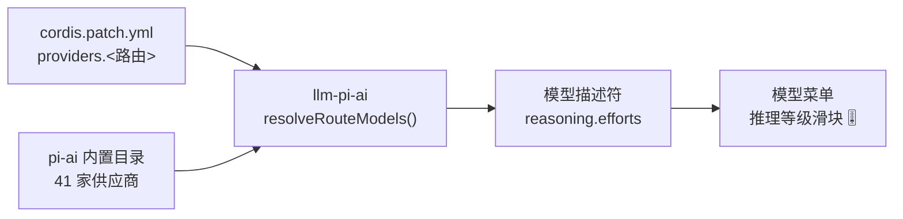

# 🎚 dsh-reasoning-presets

**让你的 DSH 模型菜单真正出现「推理等级」滑块 —— 不只是 GLM，41 家主流供应商全都适配。**

**Make the reasoning-effort slider show up for every model in DSH — GLM, Claude, GPT, Gemini, DeepSeek and 36 more.**

[](LICENSE)
[](https://nodejs.org)
[](https://github.com/deepseek-ai)
[](#)

[中文](#-中文) · [English](#-english)

---

## 🇨🇳 中文

### 问题不在滑块，而在配置

你在 `cordis.patch.yml` 里接上了 GLM，能用、能聊，但模型菜单里就是没有那一行「推理等级」。很多人以为是缺个 UI 插件——**不是**。菜单那一行完全由配置驱动：

> DSH 只有在**模型描述符带 `reasoning.efforts`** 时，才会渲染推理等级行；而这个描述符来自 `llm-pi-ai` 适配器对 pi-ai 模型目录的解析。



于是有两种结局：

| 你的路由 | 目录是否认识 | 结果 |
| --- | --- | --- |
| `id: deepseek` / `openai` / `anthropic` … | ✅ 同名 → 元数据自动继承 | 滑块直接出现 |
| `id: glm` / `id: my-proxy` … | ❌ 目录里没有 → `reasoning: false` | **没有滑块，且无从设置** |

自定义路由必须**手写** `reasoningEfforts`（档位 → 线上取值），必要时再补 `compat`（各家 chat 协议的思考参数长得都不一样）。写错一个字段，要么滑块不出现，要么请求 400。

**这个仓库就是把这件事自动化**：从你本机安装的 pi-ai 目录里读出真实能力，体检你的 profile，把该写的东西补上。

### ✨ 它能做什么

- 🔍 **体检**：一条命令看清每条路由、每个模型到底支不支持推理、支持哪几档、有没有默认档
- 🩹 **修复**：缺 `reasoningEfforts` / 缺 `api` / 缺 `compat` / 缺默认档，全部自动补齐，逐条列出改动
- 🧱 **新建**：`init` 直接生成一条「继承目录」的干净路由，从源头避免手写错误
- 🧭 **查询**：`list` 打印 41 家供应商的真实档位矩阵（也生成 `docs/MATRIX.md`）
- 🧬 **家族规则**：目录里查不到的型号（中转站的 `claude-sonnet-5-5`、新的 `glm-5.3-flashx`）按厂商家族补齐协议 / 档位 / 默认档，不用翻文档
- 🛡 **安全**：默认 dry-run；`--write` 前自动备份 `.bak`；`apply()` 绝不抛错，不会把 DSH 卡成「Failed to load plugins」

### 🚀 四条使用路径

#### 路径 A：命令行（最快，改完即生效）

需要 Node ≥ 20。DSH 的 profile 补丁在 HMR 监听列表里，**写完自动生效，不用重启**。

```bash
git clone https://github.com/tancy9527/dsh-reasoning-presets.git
cd dsh-reasoning-presets

node bin/cli.mjs root      # 1. 确认探测到了 DSH 安装目录与 profile
node bin/cli.mjs audit     # 2. 体检：谁有滑块、谁没有
node bin/cli.mjs fix       # 3. 预演修复（不写盘）
node bin/cli.mjs fix --write   # 4. 真写，自动生成 cordis.patch.yml.<时间戳>.bak
```

想全局可用：`npm i -g .`，之后直接 `dsh-reasoning audit`。

#### 路径 B：作为 DSH 插件

仓库已经带了 `cordis.patch.yml` 与 `dsh.bundle.patch`，装进 profile 后会多一个 `reasoning_presets` 工具，直接让模型自己体检/修复：

```jsonc
// profile 的 package.json → dsh.bundles
"dsh-reasoning-presets"
```

工具参数：`action`（`list` / `audit` / `fix` / `init`）、`providers[]`、`effort`、`write`、`applyDefault`、`profile`、`dshRoot`。

#### 路径 C：一条命令适配「目录里没有的型号」

pi-ai 的模型目录只认官方型号 id；中转站与刚发布的型号（`claude-sonnet-5-5`、`glm-5.3-flashx`…）不在里面，
路由就拿不到档位。仓库内置「家族规则」（`lib/recipes.mjs`）按命名规律兜底，`fix` 时**目录优先、家族兜底**：

| 家族 | 匹配的型号 | 协议 | 自动补的档位 |
| --- | --- | --- | --- |
| 智谱 GLM 5.3 | `glm-5.3*`、`glm-5-turbo` | `openai-completions` + `thinkingFormat: zai` | 低 / 高 / 最大（官方不允许关闭思考） |
| 智谱 GLM 5.2 | `glm-5.2*`、`glm-5` | 同上 | 关闭（`none`）/ 低 / 高 / 最大 |
| Claude 5.x | `claude-opus-5*`、`claude-sonnet-5*`、`claude-fable-5*` | `anthropic-messages` | 关闭 / 极简 / 低 / 中 / 高 / 极高 / 最大 |
| Claude Haiku | `claude-haiku*` | 同上 | 关闭 / 低 / 中 / 高（保守，避免上游拒绝） |

```bash
node bin/cli.mjs fix --write    # 目录优先 + 家族兜底，一次补齐
```

家族规则**只补不覆盖**：你手写过的 `reasoningEfforts` 原样保留；`fix` 还会给缺默认档的路由补
`reasoning: high`，避免菜单里那个「Default」把「不发 effort」的请求打到禁止关闭思考的型号上。

#### 路径 D：只想抄一段 YAML

**① 自定义路由（例如智谱 GLM）——必须手写**

```yaml
- id: llm-pi-ai
  name: "@deepseek-ai/dsh-llm-pi-ai"
  config:
    providers:
      glm:
        apiKeyEnv: GLM_API_KEY
        api: openai-completions          # 智谱思考参数是 chat 协议带的，不是 responses
        baseURL: https://open.bigmodel.cn/api/paas/v4
        reasoning: high                  # 默认档；不写菜单会多出一项 "Default"
        compat:
          thinkingFormat: zai            # 关键：走 zai 的 thinking/reasoning_effort 分支
          supportsReasoningEffort: true
          maxTokensField: max_tokens
          supportsStore: false
          supportsDeveloperRole: false
          supportsStrictMode: true
        models:
          - id: glm-5.3                  # 5.3 系列：官方禁止关闭思考
            reasoningEfforts: { low: low, high: high, max: max }
          - id: glm-5.2                  # 5.2 系列：可以关
            reasoningEfforts: { off: none, low: low, high: high, max: max }
```

**② 目录里已有的供应商——只要路由 id 同名，什么都不用写**

```yaml
      deepseek:                # id 与 pi-ai 目录同名
        apiKeyEnv: DEEPSEEK_API_KEY
        reasoning: high        # 默认档；档位继承目录，滑块自动出现
      anthropic:
        apiKeyEnv: ANTHROPIC_API_KEY
        reasoning: medium
```

> 目录里的 `thinkingLevelMap` / `compat` 会自动回填，你不写反而更准。

### 📊 常见供应商的真实档位

| 供应商（路由 id） | 档位 | 备注 |
| --- | --- | --- |
| `openai` | 关闭 / 极简 / 低 / 中 / 高 / 极高 / 最大 | responses 协议 |
| `anthropic` | 关闭 / 极简 / 低 / 中 / 高 / 极高 / 最大 | anthropic-messages |
| `google` | 关闭 / 极简 / 低 / 中 / 高 | 没有极高/最大 |
| `xai` | 关闭 / 低 / 中 / 高 / 极高 | |
| `deepseek` | 关闭 / 低 / 高 / 最大 | |
| `moonshotai` / `-cn` | 关闭 / 极简 / 低 / 中 / 高 / 最大 | |
| `qwen-token-plan` / `-cn` | 关闭 / 极简 / 低 / 中 / 高 / 极高 / 最大 | |
| `zai`（智谱） | 关闭 / 低 / 高 / 最大 | |
| `zai-coding-cn` | 低 / 高 / 最大 | 禁关 |
| `minimax` / `cerebras` / `together` … | 视型号而定 | `list --all` 看全表 |

完整 41 家矩阵：[`docs/MATRIX.md`](docs/MATRIX.md)（由 `dsh-reasoning list --markdown --all` 生成）。

### 🧰 命令参考

| 命令 | 作用 |
| --- | --- |
| `dsh-reasoning root` | 打印探测到的 DSH 安装目录、pi-ai 目录、profile 补丁路径 |
| `dsh-reasoning list [--all] [--markdown]` | 供应商档位矩阵（默认只列推荐路由） |
| `dsh-reasoning audit [--markdown] [--json]` | 体检当前 profile，列出问题与可修项 |
| `dsh-reasoning fix [--write] [--effort high] [--no-default]` | 补齐配置；默认 dry-run |
| `dsh-reasoning init <id…> [--write]` | 新建继承目录的路由 |

通用参数：`--profile <dir>`、`--patch <file>`、`--dsh-root <dir>`、`--base-url id=url`（覆盖 `baseURL`，用于中转站）。

### ✅ 实测记录（不是纸面推演）

用 DSH 真正使用的链路（`dsh-llm-pi-ai` → pi-ai `openai-completions` → 智谱
`/api/paas/v4/chat/completions`）对**真实上游**发请求，同一句问题只改档位：

| 档位 | 思考 tokens | 思考文本 | 回答长度 |
| --- | --- | --- | --- |
| 低 `low` | **0** | 无 | 464 字 |
| 高 `high` | **553** | 1751 字 | 388 字 |
| 最大 `max` | **449** | 1514 字 | 513 字 |

- 低档完全不思考、高档稳定思考上千字 ⇒ 滑块确实作用到了线上参数（`thinking:{type:"enabled"}` + `reasoning_effort`）。
- DeepSeek 官方 `deepseek-chat` 同样 200，`reasoning_effort` 生效。
- Claude 侧只做了**请求体层面**的验证（中转站账号欠费，上游在参数校验前就返回 `403 INSUFFICIENT_BALANCE`）：
  DSH 实际会发 `thinking:{type:"enabled", budget_tokens: 2048 | 16384, display:"summarized"}`
  —— 低档 2048，中/高/极高/最大 16384（pi-ai 的 anthropic 预算表上限），选「关闭」则完全不发 `thinking`。
- 想让 Claude 用新版的 `thinking:{type:"adaptive"}` + `output_config.effort`，需要**路由 id 与目录同名**（`anthropic`）
  才能继承 `compat.forceAdaptiveThinking`；`claude` 这种自定义 id 只能走上面那条 `budget_tokens` 路径。

### ❓ FAQ

**Q：为什么菜单里多了一项「Default」？**
A：「Default」不是档位，是 `defaultEffort` 缺失时 DSH 自动补的伪选项——选中它意味着**请求里不带任何 effort**，由服务商决定。对「禁止关闭思考」的型号（GLM-5.3 系列等）这有 400 风险。给路由写上 `reasoning: high` 即可让它消失。

**Q：我用的是中转站 / 自建代理，模型 id 目录里没有怎么办？**
A：先跑 `fix`——它会按「家族规则」自动认出 `glm-*` / `claude-*` 这类型号并补齐协议与档位；目录里有的型号永远优先用目录信息。只有两边都认不出的型号（比如 `ghost-9000`）才需要你手写 `reasoningEfforts`，`audit` 会把它们单独列成「目录未收录 · 需手写」。

**Q：改完要重启 DSH 吗？**
A：不用。profile 的 `cordis.patch.yml` 在 HMR 监听列表里，保存即热更新。

**Q：改坏了怎么办？**
A：`--write` 每次都会先存 `cordis.patch.yml.<ISO时间戳>.bak`；dry-run 永远可以先用。

**Q：为什么我的 `node --test` 报 `spawn EPERM`？**
A：那是在沙箱环境里；直接跑文件即可：`node test/levels.test.mjs` 等四个文件，共 24 项断言。

### 🗂 仓库结构

```
lib/levels.mjs    档位规则（supportedLevels / effortsFor / pickDefaultLevel）
lib/catalog.mjs   定位 DSH 安装目录 + 读取 pi-ai 目录
lib/presets.mjs   40+ 供应商元数据（apiKeyEnv / 中文名 / 文档链接）
lib/patch.mjs     cordis.patch.yml 读写（保留注释、自动备份）
lib/audit.mjs     audit / fix / init 三个核心算法
lib/recipes.mjs   家族规则（目录里没有的 glm-* / claude-* 型号靠它兜底）
lib/render.mjs    文本与 markdown 渲染
lib/index.mjs     插件入口（reasoning_presets 工具）
bin/cli.mjs       命令行
docs/PLUMBING.md  机制详解：reasoningEfforts 语义、目录继承、compat 白名单、各家 wire 差异
```

### 📚 想搞清楚原理？

读 [`docs/PLUMBING.md`](docs/PLUMBING.md)。里面有 `resolveRouteModels` 的继承规则、`reasoningEfforts` 的三种特殊值（`false` / `null` / 缺省）、各协议 compat 白名单，以及常见报错信息的对照表。

### 📄 License

MIT © 2026 tancy9527

---

## 🇬🇧 English

### The slider is a config problem, not a UI problem

You wired GLM into `cordis.patch.yml`. It answers. But the model menu never shows a **reasoning effort** row. It is easy to assume a UI plugin is missing — it is not. That row is rendered purely from data:

> DSH renders the effort row only when the **model descriptor carries `reasoning.efforts`** — and that descriptor is produced by the `llm-pi-ai` adapter from the bundled pi-ai model catalog.

So there are only two outcomes:

| Your route id | Known to the catalog? | Result |
| --- | --- | --- |
| `deepseek`, `openai`, `anthropic`, … | ✅ same id → metadata inherited | slider appears |
| `glm`, `my-proxy`, … | ❌ unknown → `reasoning: false` | **no slider, nothing to pick** |

Custom routes must **declare** `reasoningEfforts` (level → wire value) by hand, plus `compat` where the vendor's chat protocol spells thinking differently. One wrong field and you either get no slider or a `400`.

**This repo automates that**: read the real capabilities from the pi-ai catalog shipped with your DSH install, audit your profile, and write back exactly what is missing.

### ✨ What it does

- 🔍 **Audit** — one command tells you, per route and per model, whether reasoning works, which levels exist, and whether a default is set
- 🩹 **Fix** — missing `reasoningEfforts` / `api` / `compat` / default effort are filled in, with a changelog
- 🧱 **Init** — generate clean catalog-inheriting routes instead of hand-writing them
- 🧭 **List** — print the real level matrix for 41 providers (also generates `docs/MATRIX.md`)
- 🧬 **Family recipes** — relay / brand-new models the catalog has never seen (`claude-sonnet-5-5`, `glm-5.3-flashx`) still get protocol, levels and a default
- 🛡 **Safe** — dry-run by default, timestamped `.bak` before every write, and `apply()` never throws (so DSH never reports the plugin as failed)

### 🚀 Four ways to use it

#### A. CLI (fastest — takes effect immediately)

Node ≥ 20. The profile patch file is watched by DSH's HMR layer, so **no restart needed**.

```bash
git clone https://github.com/tancy9527/dsh-reasoning-presets.git
cd dsh-reasoning-presets

node bin/cli.mjs root          # 1. show detected install dir + profile patch
node bin/cli.mjs audit         # 2. who has a slider, who doesn't
node bin/cli.mjs fix           # 3. dry-run the repair
node bin/cli.mjs fix --write   # 4. apply (auto .bak backup)
```

Install globally: `npm i -g .` → then `dsh-reasoning audit`.

#### B. As a DSH plugin

The repo ships `cordis.patch.yml` + `dsh.bundle.patch`, so installing it into a profile exposes a `reasoning_presets` tool — let the agent audit and repair itself:

```jsonc
// profile package.json → dsh.bundles
"dsh-reasoning-presets"
```

Tool arguments: `action` (`list` / `audit` / `fix` / `init`), `providers[]`, `effort`, `write`, `applyDefault`, `profile`, `dshRoot`.

#### C. One command for models the catalog has never heard of

The pi-ai catalog only knows official model ids. Relay and freshly released models
(`claude-sonnet-5-5`, `glm-5.3-flashx`, …) are not in it, so the route never gets any levels.
The repo ships **family recipes** (`lib/recipes.mjs`) that fill the gap from naming patterns —
catalog first, family as fallback:

| Family | Matches | Protocol | Levels filled in |
| --- | --- | --- | --- |
| Zhipu GLM 5.3 | `glm-5.3*`, `glm-5-turbo` | `openai-completions` + `thinkingFormat: zai` | low / high / max (vendor forbids disabling thinking) |
| Zhipu GLM 5.2 | `glm-5.2*`, `glm-5` | same | off (`none`) / low / high / max |
| Claude 5.x | `claude-opus-5*`, `claude-sonnet-5*`, `claude-fable-5*` | `anthropic-messages` | off / minimal / low / medium / high / xhigh / max |
| Claude Haiku | `claude-haiku*` | same | off / low / medium / high (conservative) |

```bash
node bin/cli.mjs fix --write    # catalog first, family fallback, everything listed
```

Recipes **never overwrite** hand-written `reasoningEfforts`, and `fix` also adds
`reasoning: high` to routes without a default — so the menu never shows the "Default"
pseudo-entry that would send *no* effort to models that cannot disable thinking.

#### D. Just copy the YAML

**① Custom route (e.g. Zhipu GLM) — must be written by hand**

```yaml
- id: llm-pi-ai
  name: "@deepseek-ai/dsh-llm-pi-ai"
  config:
    providers:
      glm:
        apiKeyEnv: GLM_API_KEY
        api: openai-completions          # Zhipu carries thinking in the chat protocol, not responses
        baseURL: https://open.bigmodel.cn/api/paas/v4
        reasoning: high                  # default level; omit it and a "Default" pseudo-entry appears
        compat:
          thinkingFormat: zai            # key: route through zai's thinking / reasoning_effort branch
          supportsReasoningEffort: true
          maxTokensField: max_tokens
          supportsStore: false
          supportsDeveloperRole: false
          supportsStrictMode: true
        models:
          - id: glm-5.3                  # 5.3 family cannot disable thinking
            reasoningEfforts: { low: low, high: high, max: max }
          - id: glm-5.2                  # 5.2 family can
            reasoningEfforts: { off: none, low: low, high: high, max: max }
```

**② Providers already in the catalog — inherit by keeping the route id**

```yaml
      deepseek:                # same id as the pi-ai catalog
        apiKeyEnv: DEEPSEEK_API_KEY
        reasoning: high        # default level; levels + compat inherited
      anthropic:
        apiKeyEnv: ANTHROPIC_API_KEY
        reasoning: medium
```

> The catalog's own `thinkingLevelMap` / `compat` are more accurate than anything you would type.

### 📊 Level matrix (highlights)

| Provider (route id) | Levels | Notes |
| --- | --- | --- |
| `openai` | off / minimal / low / medium / high / xhigh / max | responses protocol |
| `anthropic` | off / minimal / low / medium / high / xhigh / max | anthropic-messages |
| `google` | off / minimal / low / medium / high | no xhigh/max |
| `xai` | off / low / medium / high / xhigh | |
| `deepseek` | off / low / high / max | |
| `moonshotai` (±`-cn`) | off / minimal / low / medium / high / max | |
| `qwen-token-plan` (±`-cn`) | off / minimal / low / medium / high / xhigh / max | |
| `zai` | off / low / high / max | |
| `zai-coding-cn` | low / high / max | cannot disable |

Full 41-provider matrix: [`docs/MATRIX.md`](docs/MATRIX.md) (generated by `dsh-reasoning list --markdown --all`).

### 🧰 Command reference

| Command | Purpose |
| --- | --- |
| `dsh-reasoning root` | Print detected DSH root, pi-ai dir and profile patch path |
| `dsh-reasoning list [--all] [--markdown]` | Provider level matrix (recommended routes by default) |
| `dsh-reasoning audit [--markdown] [--json]` | Audit the profile and list issues |
| `dsh-reasoning fix [--write] [--effort high] [--no-default]` | Repair; dry-run unless `--write` |
| `dsh-reasoning init <id…> [--write]` | Create catalog-inheriting routes |

Shared flags: `--profile <dir>`, `--patch <file>`, `--dsh-root <dir>`, `--base-url id=url` (for proxies/relays).

### ✅ What was actually measured

Real requests through the exact code path DSH uses (`dsh-llm-pi-ai` → pi-ai
`openai-completions` → Zhipu `/api/paas/v4/chat/completions`), same prompt, only the level changed:

| Level | Thinking tokens | Thinking text | Answer |
| --- | --- | --- | --- |
| `low` | **0** | none | 464 chars |
| `high` | **553** | 1751 chars | 388 chars |
| `max` | **449** | 1514 chars | 513 chars |

- `low` does not think at all, `high`/`max` think for well over a thousand characters — the slider really
  reaches the wire (`thinking:{type:"enabled"}` + `reasoning_effort`).
- Official `deepseek-chat` also returns 200 with `reasoning_effort` honoured.
- Claude was verified at the **request-body** level only (the relay account is out of balance and returns
  `403 INSUFFICIENT_BALANCE` before it ever validates the body): DSH sends
  `thinking:{type:"enabled", budget_tokens: 2048 | 16384, display:"summarized"}` — 2048 for `low`,
  16384 for medium/high/xhigh/max (pi-ai's anthropic budget ceiling), and nothing at all when disabled.
- To get the newer `thinking:{type:"adaptive"}` + `output_config.effort` shape for Claude, the route id must
  match the catalog (`anthropic`) so it inherits `compat.forceAdaptiveThinking`; a custom id like `claude`
  only ever takes the `budget_tokens` path.

### ❓ FAQ

**Why does my menu show an extra "Default" entry?**
It is not a level. When `defaultEffort` is missing, DSH adds a pseudo-choice that sends **no effort at all** and lets the provider decide. For models that forbid disabling thinking (GLM-5.3 family, …) that risks a `400`. Set `reasoning: high` on the route and it disappears.

**I use a relay / self-hosted proxy and my model ids aren't in the catalog.**
Run `fix` first — family recipes recognise `glm-*` / `claude-*` style ids and fill in protocol, levels and a default; catalog entries always win when they exist. Only models neither side knows (say `ghost-9000`) need hand-written `reasoningEfforts`, and `audit` lists them as "not in catalog · write it yourself".

**Do I need to restart DSH?**
No. The profile `cordis.patch.yml` is watched; saving hot-reloads it.

**What if I break something?**
Every `--write` saves `cordis.patch.yml.<ISO timestamp>.bak` first. Always dry-run first.

**`node --test` fails with `spawn EPERM`?**
That happens inside sandboxed environments. Run the files directly: `node test/levels.test.mjs`, `node test/audit.test.mjs`, `node test/patch.test.mjs`, `node test/recipes.test.mjs` — 24 assertions total.

### 🗂 Layout

```
lib/levels.mjs    level rules (supportedLevels / effortsFor / pickDefaultLevel)
lib/catalog.mjs   locate the DSH install + load the pi-ai catalog
lib/presets.mjs   40+ provider metadata (env var / display name / docs)
lib/patch.mjs     cordis.patch.yml read/write (keeps comments, makes backups)
lib/audit.mjs     audit / fix / init algorithms
lib/recipes.mjs   family recipes for model ids the catalog does not ship
lib/render.mjs    text and markdown rendering
lib/index.mjs     plugin entry (reasoning_presets tool)
bin/cli.mjs       CLI
docs/PLUMBING.md  internals: reasoningEfforts semantics, inheritance, compat gates, wire differences
```

### 📚 Want the internals?

Read [`docs/PLUMBING.md`](docs/PLUMBING.md): `resolveRouteModels` inheritance, the three special `reasoningEfforts` values (`false` / `null` / absent), per-protocol `compat` allow-lists, and a mapping of the error messages you will hit.

### 📄 License

MIT © 2026 tancy9527
